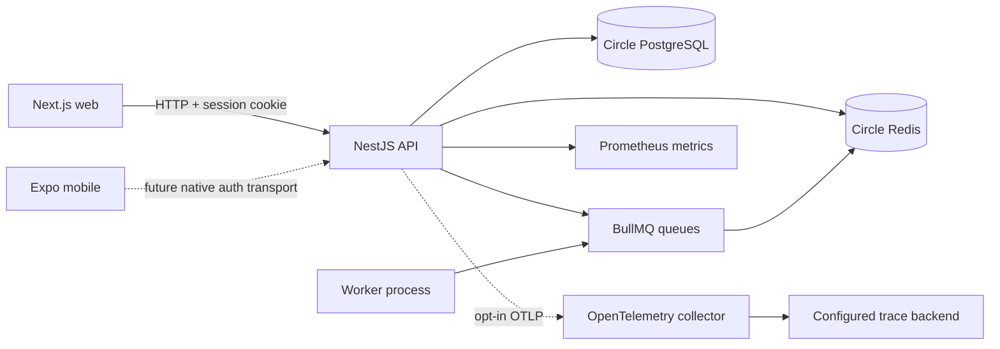

# System architecture

The API is a modular monolith. The worker is a separately deployable process, not another Nest application. Modules in `apps/api/src/core/modules.ts` own database, cache, queues, authentication, health, and communities. Runtime configuration is validated before dependency connections are created. Future users and security workflows should remain within the API until deployment or scale requirements justify separation.

Shared packages own transport-facing contracts rather than re-exporting Prisma persistence models. API timestamps are serialized ISO strings; internal database timestamps are Date objects. Validation contains Zod schemas; config contains typed environment parsing; constants contains queue policies and stable canonical community identifiers; design tokens use platform-neutral numbers and colors. API client handles envelopes, cookies, optional authorization headers and sanitized HTTP failures.

Applications consume shared packages through `workspace:*`. Turbo builds upstream packages before consumers, generates Prisma before the API build, and disables caching for live integration tests. Generated Prisma sources and all `dist` directories are ignored. Root TypeScript is 6.0.3; framework-specific compiler settings remain in each application.

## Data flow

A request receives a bounded request ID, request metrics, strict body-size limits, CORS and security headers, Redis throttling, validation, a controller operation, then a standard response envelope. Authentication operations additionally require the exact trusted Origin. Database credentials never enter responses or logs. Background jobs carry identifiers rather than sensitive bodies; handlers must retrieve authorized data and remain idempotent.

## Background jobs

Namespaced queues: notifications, media, moderation, maintenance. Only maintenance `healthcheck` is implemented. Unregistered jobs are rejected with an unrecoverable failure rather than falsely reported as completed. Producers use bounded retries; workers use long-lived retrying Redis connections. Defaults: three attempts, exponential backoff from one second, bounded completed/failed retention. Failed jobs remain inspectable; operators retry only after fixing the cause. Shutdown stops intake, waits for active processors, and closes Redis. Jobs must be designed for at-least-once delivery.

## Real-time and media boundaries

Socket.IO and Cloudflare R2 are future adapter boundaries, not deployed dependencies in this foundation. Before real-time features, authenticate sockets using the same session authority, enforce origin and per-room authorization, and load-test reconnect/fan-out. Before media features, add server-issued short-lived upload capabilities, object size/type validation, isolated processing and signed download policy. No storage account or bucket was provisioned.
