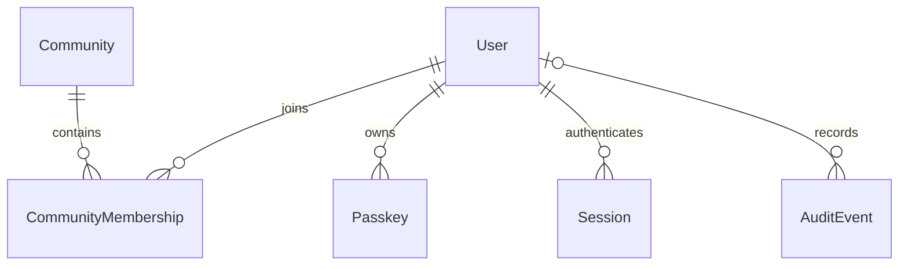

# Database development

Circle.social uses PostgreSQL 16 in its own container and volume. The API uses Prisma 7.10.1 with the pg driver adapter; `prisma.config.ts` loads the ignored environment file and supplies the CLI datasource. Runtime adapter pooling is capped by `DATABASE_POOL_MAX` (default 10), with five-second connection/query limits and 30-second idle timeout. Budget total connections across API replicas and workers; workers currently do not connect to PostgreSQL.

## Schema



Users hold UUID identities, unique public handles and lifecycle status. Communities hold unique slugs and display metadata. Memberships have a composite user/community primary key, roles, and an index on community/joinedAt for member lists. Passkeys store credential IDs, COSE public keys, signature counters, transport and backup metadata; private authenticator keys never reach the server. Sessions store only SHA-256 token hashes, expiration and revocation state. Audit events retain event kinds and optional user references without tokens, IPs or request bodies.

Foreign-key membership/passkey/session rows cascade when a user is deliberately deleted. Audit actor references become null. Public handles and slugs have unique indexes; passkeys index users; sessions index users/expiration and token hash; audit events index actor/time. UUID defaults are generated by Prisma; updatedAt values are maintained by Prisma. Review these semantics before raw SQL writers are introduced.

## Migrations

```sh
pnpm --filter api db:validate
pnpm --filter api db:generate
pnpm --filter api db:migrate --name describe_change
pnpm --filter api db:status
```

Review the migration SQL and commit it with the schema. `migrate dev` is local development only; never accept a reset prompt against valuable data. Deployment uses `pnpm --filter api db:deploy` after a verified backup. Use additive changes and explicit data backfills; do not run `db push` against deployed databases. Schema generation is separate from migration application in Prisma 7.

Two initial migrations establish communities/memberships and passkeys/sessions/audit events. Test preparation creates only `circle_social_test`, deploys the same migrations, and refuses other database names or non-local hosts. Tests delete only their generated `cs_test_` user and use Redis database 1. No database reset or FLUSHALL is part of normal testing.

## Seeding

```sh
pnpm --filter @circle/constants --filter @circle/validation build
pnpm --filter api db:seed
```

The five canonical definitions live in `@circle/constants`: Bhasar (`bhasar`), Papaki Pari (`papaki-pari`), Dukhi Aatma (`dukhi-aatma`), Khushi Ki Pujari (`khushi-ki-pujari`), Baap Ka Paisa (`baap-ka-paisa`). Zod validates them before a single transactional upsert. Repeating the seed preserves existing UUIDs, slugs, descriptions, active state and memberships. Names/slugs are product contracts; changing a slug requires an explicit reviewed migration and redirect strategy. Seeding never deletes other communities.

## Backups and recovery

`sh infrastructure/scripts/backup.sh` creates a private custom-format dump in ignored `artifacts/backups`. Treat it as sensitive user data. `sh infrastructure/scripts/restore.sh PATH.dump` restores only into a new `circle_social_restore` scratch database and refuses to reuse an existing scratch database. Verify table counts and application queries before a controlled recovery. Encrypt backups off-device and define retention before real user data exists.

Normal shutdown is `pnpm infra:down`; volumes survive. A destructive reset is intentionally not scripted. If disposable Circle.social data must be discarded, first verify backups, inspect the exact `circle_postgres_data` / `circle_redis_data` names, stop only Circle.social, and remove only those two volumes manually. Never use Docker-wide prune or remove `adskradscoin_*` resources.

The Circle.social PostgreSQL image is built from a pinned official PostgreSQL 16 Alpine digest and runs directly as the `postgres` user. Its unused `gosu` privilege-switching binary is removed, reducing both privilege and an outdated embedded Go runtime. This changes only Circle.social’s image, not the existing `ads_postgres` service or its image/volume.
